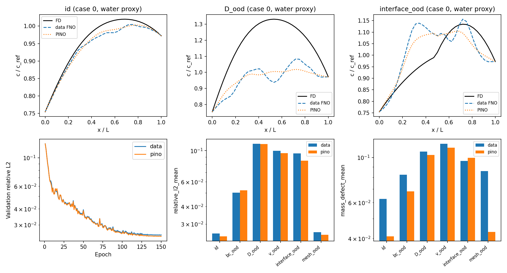

# MEA 수송을 위한 작은 physics-informed FNO 검증

이 예제는 **1D 정상상태의 독립적인 두 유효 수송장**을 학습한다. 첫 채널은 물 농도, 두 번째는 이온 농도의 대리 변수다. 두 장 사이의 수화–전도도 결합, 전기이동, 전류, 전극 반응 메커니즘은 아직 없다. 따라서 실제 MEA 성능·전압·FE·안정성 또는 EIS를 예측한다고 해석할 수 없다.

원본 저장소의 `examples/models/plot_FNO_darcy.py`에서 사용한 실제 `neuralop.models.FNO`를 1D로 구성하고, `examples/data_gen/plot_diffusion_advection_solver.py`의 방정식 → 합성 공간장 흐름을 가져왔다. 원본 예제의 코드를 실행해 MEA 모델이라고 재명명한 것은 아니다. 기준해는 경계조건과 질량수지를 명시적으로 검사할 수 있도록 별도 구현했다. `neuralop` 본체는 수정하지 않았다.

## 실행

저장소 루트, Python 3.12에서 실행한다. 원격 데이터 다운로드, API 키, 실험 데이터, W&B 계정은 필요 없다.

```bash
python -m venv .venv
source .venv/bin/activate
# 재현용 CPU 환경. CUDA 환경에는 이 CPU lock을 사용하지 않는다.
python -m pip install -r examples/mea_transport/requirements-lock-cpu.txt
python -m pip install -e . --no-deps
python -m pytest examples/mea_transport/tests -q
python -m examples.mea_transport.run --out examples/mea_transport/runs/cpu_seed20261016
```

3개 seed 비교를 재현하려면 아래 두 실행을 추가한다. 각 seed마다 데이터 분할, 초기화, minibatch 순서가 바뀐다. 같은 seed의 일반 FNO와 PINO는 같은 초기화·데이터·순서를 사용한다.

```bash
python -m examples.mea_transport.run --seed 20261017 --out examples/mea_transport/runs/cpu_seed20261017
python -m examples.mea_transport.run --seed 20261018 --out examples/mea_transport/runs/cpu_seed20261018
python -m examples.mea_transport.summarize
```

가벼운 설치/파이프라인 점검:

```bash
python -m examples.mea_transport.run --epochs 2 --n-train 64 --n-val 16 --n-test 8 --out examples/mea_transport/runs/smoke
```

CUDA 버전 PyTorch가 설치된 호스트에서는 같은 설정으로 `--device cuda --out examples/mea_transport/runs/cuda`를 사용한다. GPU가 없으면 명시적으로 실패한다. 모든 정상 실행은 사용 가능한 CPU/CUDA 양쪽에서 같은 checkpoint의 추론과 학습 step을 벤치마크한다. GPU가 없을 때는 `available: false`를 기록한다. CUDA 시간에는 warmup과 synchronize가 적용된다. 측정 범위는 모델 연산이며, 초기 import/컴파일/입출력/host-device 복사는 제외한다. `cuda.max_memory_allocated`는 PyTorch tensor peak이며 전체 `nvidia-smi` 사용량이 아니다.

생성물은 `runs/` 아래에 저장된다: `training.npz`, split별 기준해/예측 `.npz`, `data.pt`, `pino.pt`, `metrics.json`, `comparison.png`. 큰 배열과 가중치는 Git에서 제외하며 seed와 설정으로 다시 만들 수 있다. `results/`에는 실제 실행의 수치, 집계, 대표 그림을 보존했다. 두 모델 모두 검증셋 **농도 relative L2**가 가장 작은 epoch를 사용한다. 테스트셋은 학습·정규화·checkpoint 선택에 쓰지 않는다. 손실 가중치와 150 epoch 설정은 세 seed에서 동일하게 유지했다.

## 최소 물리 문제

각 채널 s에 대해 x∈[0,1]에서:

$$J_s=v_s c_s-D_s(x)\partial_x c_s,\qquad \partial_x J_s=s_s(x)-k_s c_s.$$

양 끝은 지정 농도(Dirichlet)다. 시간축은 없으며 질량검증은 **정상상태 유입–유출–생성–소모 수지**다. 저장량 변화나 transient 안정성을 검증하지 않았다. `v`는 부호가 있는 유효 이류/드리프트 속도이며, 전기삼투 항을 구현한 것은 아니다.

| 학습 변수 | 무차원 분포 |
|---|---|
| 격자 | 노드 33개, h=1/32 |
| D(x) | D0 exp[A sin(2πx+φ)], D0∈[0.05,0.18], A∈[-0.45,0.45], φ∈[0,2π] |
| v | [-0.18,0.18], 공간적으로 일정 |
| k | [0,0.6], 공간적으로 일정 |
| source(x) | S0[1+0.2 sin(πx)], S0∈[0,0.2] |
| c_left, c_right | 각각 독립적으로 [0.2,1.0] |
| 표본 수 | 학습 512, 검증 96, 테스트 각 조건 128 |

두 채널의 계수는 같은 분포에서 독립적으로 생성한다. 채널 이름만으로 물/이온의 실제 물성이 부여되지는 않는다. 농도가 수화도 λ나 물 활성도 a_w인 것도 아니다. 실제 의미를 부여하려면 단위/기준농도 및 흡착 평형식이 필요하다.

기준해는 nodal conservative finite differences(내부 control-volume과 동등), 면에서 조화평균 D, 부호에 따른 1차 upwind 이류, 3중 대각 직접해법이다. 안정한 elliptic 기준 문제를 선택했으며 시간 적분 CFL 조건은 없다. upwind의 수치확산은 남는다.

FNO는 width=24, 3 layers, modes=(12,), padding=0.25, 13개 입력 채널에서 2개 농도장을 예측한다. 입력은 `[log(D/0.1)×2, v/0.2×2, k/0.8×2, source/0.2×2, c_left×2, c_right×2, x]`. 출력은 선형 경계 lift에 `4x(1-x)FNO`를 더한다. 경계는 부동소수점 반올림 수준으로 정확하지만 보존식과 양수성은 hard constraint가 아니다.

일반 FNO: 채널/샘플별 상대 농도 MSE. PINO: 같은 data loss + `0.01 mean(r²) + 0.1 mean(B²)`. `r=∂hJ+kc-source`, `B=J_R-J_L+hΣ(kc-source)`다. 유한차분 residual을 자동미분해 학습한다. 여기서는 학습 격자에서만 물리 손실을 계산하므로 **physics-regularized FNO/PINO prototype**이라는 의미다. 원 PINO 논문의 고해상도 residual 학습이나 label-free 학습, 연속 방정식의 정확한 보존을 구현했다고 주장하지 않는다.

## 검증 정의와 실제 결과

- relative L2: 각 샘플·채널의 `||prediction−FD||₂/||FD||₂`를 평균. p95와 채널별 평균도 JSON에 보존한다.
- 질량수지 상대 오차: `|J_R−J_L+hΣ(kc−source)|/(|J_R|+|J_L|+hΣ|source|+hΣ|kc|+1e−10)`. 내부 노드를 감싸는 면 h/2와 1−h/2에서 평가한다. 경계 노드 자체의 물리 표면 flux와 혼동하지 않는다. 농도장을 사후 보정하지 않는다.
- 정확한 선형 확산해, source를 직접 유도한 manufactured continuum solution의 격자 수렴, 기준해의 수지, NumPy/PyTorch residual 일치, 경계, gradient, checkpoint 재로딩, 단위/임피던스 부호 계약을 테스트한다.
- PINO와 FD가 같은 stencil을 쓰는 검증만으로 continuum 정확도가 증명되지는 않는다. 독립적으로 제조한 연속해에서 upwind 해의 1차 수렴을 확인하고, ID 테스트의 33노드 해와 129노드 해를 비교한다. 후자는 전체 OOD의 수렴 보장은 아니다.
- mesh OOD는 학습하지 않은 65노드 입력이며 같은 연속 계수/경계 표본을 사용한다. 단순한 입력 보간 후 33노드 출력 보간 방식이 아니다.

<!-- RESULTS_TABLE -->

3개 seed의 평균. 괄호는 seed별 평균의 최소–최대이며 confidence interval이 아니다. 모든 값은 %다.

| 조건 | 일반 FNO 농도 L2 | PINO 농도 L2 | 일반 FNO 질량수지 | PINO 질량수지 |
|---|---:|---:|---:|---:|
| id | 2.42 (2.21–2.57) | 2.31 (2.12–2.45) | 6.09 (6.00–6.25) | 4.06 (3.63–4.44) |
| bc_ood | 5.09 (4.62–5.63) | 4.80 (4.40–5.23) | 8.15 (6.09–10.16) | 6.52 (5.29–7.45) |
| D_ood | 12.85 (11.19–14.18) | 12.39 (11.15–13.51) | 10.94 (10.66–11.45) | 10.62 (10.28–10.91) |
| v_ood | 8.31 (7.45–9.95) | 7.80 (6.58–9.59) | 10.27 (8.94–11.68) | 9.31 (8.04–11.17) |
| interface_ood | 11.11 (9.54–12.55) | 9.93 (8.47–10.94) | 12.37 (9.61–15.17) | 12.21 (9.96–14.03) |
| mesh_ood | 2.47 (2.27–2.63) | 2.36 (2.17–2.52) | 8.16 (7.66–8.57) | 4.28 (3.84–4.68) |

FD 33→129 노드 해 차이의 평균 L2는 seed별 0.108%, 0.117%, 0.113%다. 이 값은 연속 참해에 대한 엄밀한 error bound가 아니며, network 오차와 별도로 보고한다.

<!-- END_RESULTS_TABLE -->

OOD 조건: BC는 left=[1.15,1.5], right=[0.05,0.15]; D는 전체 확산계수를 0.25배; v는 |v|=[0.35,0.5]; interface는 x=0.5에서 D가 1/5로 감소하는 계단이다. interface는 보존 flux 조건은 있지만 분배계수/계면 저항은 없는 수치적 물성 경계다. 각 OOD를 별도로 평가하며 이들을 동시에 바꾸는 복합 OOD는 검증하지 않았다.

농도 오차와 보존 오차를 함께 봐야 한다. 물리 손실은 이 작은 검증에서 여러 지표를 개선하지만 모든 seed·모든 OOD에서 우월하지 않다. **OOD 대체 솔버, 실제 MEA 설계 또는 물성 역추정용으로는 아직 승인할 수준이 아니다.** 범위 밖에서는 기준해로 검산해야 한다. 3개 seed는 편차 확인을 위한 작은 반복이며 통계적 성능 보장은 아니다.



## CPU와 GPU 자원 판단

<!-- RESOURCE_TABLE -->

CPU 실측: AMD EPYC 9V74 80-Core Processor, PyTorch threads=2, Python 3.12.14, torch 2.14.1+cpu. 공유 VM이므로 workstation 절대시간 보장은 아니다.

| 항목 | 실측/계산값 |
|---|---:|
| PINO 학습 150 epoch + 매 epoch 검증 | 평균 15.2 s, 범위 14.9–15.8 s |
| 대표 seed FNO 한 개 추론, 33노드 | 0.960 ms |
| 대표 seed FD 한 개 해, 33노드 | 0.071 ms |
| 대표 seed FNO/FD 128개 배치 | 8.071 / 5.400 ms |
| 모델 파라미터 (복소수를 실수 2개로 계산) | 29,138 |
| 파라미터 tensor 크기 | 113.8 KiB |
| 파라미터+gradient+Adam 상태 tensor 하한 | 455.3 KiB |
| 첫 전체 실행 process peak RSS | 439.9 MiB |
| GPU 시간 / VRAM 실측 | GPU 없음: 측정 안 됨 |

<!-- END_RESOURCE_TABLE -->

이 문제의 직접해법은 O(N) banded solve라 매우 싸다. 한 개 계산에서 FNO의 시간 이득은 없으며, 배치도 하드웨어에 따라 직접해가 더 빠르다. 학습 비용을 상쇄할 경제적 근거가 현재 문제에는 없다. 이 실험의 목적은 surrogate가 필요한 더 큰 물리 모델로 가기 전에 검증 절차를 확보하는 것이다.

GPU 속도·VRAM은 이 실행 환경에서 측정할 수 없었다. 기록된 파라미터+gradient+Adam tensor 하한은 CUDA context, FFT workspace, activation, allocator를 포함하지 않는다. 따라서 이 하한만으로 특정 GPU에서 fit된다고 단정하면 안 된다. 이 작은 1D 문제에는 CPU로 시작할 근거가 충분하다. T400 4 GB 같은 GPU의 fit 여부와 속도 이득은 위 CUDA 명령으로 확인해야 하며, 지금 A100 또는 다중 GPU가 필요하다는 근거는 없다. 이 결과를 2D/3D·transient·coupled MEA의 학습시간으로 외삽하지 않는다.

2D로 확장하면 activation은 대략 batch×격자점수×hidden width×layer 수에 따라 커지고, spectral weight는 유지 mode 수의 곱에 따라 증가한다. 2D 64², 128², transient window를 순차 벤치마크해 실측 peak와 wall time으로 자원 배정을 정하는 것이 다음 단계다. 구매 가격이나 GPU 시간 비용은 조사/측정하지 않았으므로 제시하지 않는다.

## DFT·MD·MLIP 및 EIS와 연결하는 계약

`interfaces.py`, `interfaces/transport_request.json`, `interfaces/eis_metadata.json`, `interfaces/eis_observation.csv`가 실행 가능한 계약/합성 예제다. JSON/CSV 숫자는 **가상값**이며 사용자 실험이나 문헌 물성을 가장하지 않는다.

SI 수송 입력 계약 `mea_transport_si_v1`:

| 입력 | 단위/형식 | 모델 연결 |
|---|---|---|
| length_m, x_m | m; 균일한 17개 이상 노드, 0…L | 현재 같은 topology·1D 격자만 지원 |
| D_m2_s | (2,N) 또는 채널별 상수 | 유효 chemical diffusivity; 대각 tensor의 1D 성분에 해당 |
| v_m_s | m/s, 동일 형식 | 검증 학습 범위에서는 공간적으로 일정 |
| k_per_s | 1/s | 단순 선형 소모 closure; 실제 촉매 반응 속도가 아님 |
| source_mol_m3_s | mol m⁻³ s⁻¹ | 학습 분포는 지정된 sin 공간형태 |
| boundary_left/right_mol_m3 | 각 채널의 mol/m³ | Dirichlet 종류만 지원; flux/Robin BC 일반화는 미검증 |
| D_ref_m2_s, concentration_ref_mol_m3 | 양의 기준값 | 무차원화를 명시, 숨은 단위 변환 방지 |
| provenance | method, material_id, T, a_w, FF/DFT 설정, 불확실성 | 물성의 출처·적용 범위 기록; 학습 입력으로 아직 사용하지 않음 |

무차원화는 `D*=D/D_ref`, `v*=vL/D_ref`, `k*=kL²/D_ref`, `source*=source L²/(D_ref c_ref)`다. 출력 `mea_transport_prediction_si_v1`에는 x별 농도, face flux 및 face 위치, 주변 범위 OOD flag가 들어간다. 주변 범위 flag만으로 joint distribution이나 새로운 물성장 형태를 판별할 수 없다. source/계수의 공간형태를 바꾸면 범위 안이라도 분포 밖일 수 있다. 불확실성 추정기는 아직 없으며 flag가 비어도 신뢰성을 보증하지 않는다.

```bash
python -m examples.mea_transport.interfaces --request examples/mea_transport/interfaces/transport_request.json --checkpoint examples/mea_transport/runs/cpu_seed20261016/pino.pt --output examples/mea_transport/runs/cpu_seed20261016/si_prediction.json
```

DFT→MD→전달 모델의 연결은 아래처럼 구현을 확장해야 한다. 서로 다른 scale의 수치를 그대로 concatenate하지 않는다.

| 원자 수준 결과 | 필요한 변환/검증 | 향후 전달 모델 입력 |
|---|---|---|
| DFT 수화·흡착 자유에너지, 계면 protonation, 장벽 | coverage/전위/pH/온도 의존 isotherm 또는 microkinetics; ΔG/장벽만으로 D를 결정할 수 없음 | λ(a_w,T), 계면 분배/교환계수, reaction closure |
| MD/MLIP 물/이온 MSD와 상관함수 | 확산 영역·finite size·불확실성, tracer→chemical diffusion의 thermodynamic factor; 상관효과와 collective transport 검증 | D_water(λ,T), transport matrix, electro-osmotic drag |
| 비반응성 MD의 OH⁻/H⁺ 이동 | 구조 확산/양성자 hopping 누락을 확인; 필요한 reactive/validated transport 모델 추가 | σ(λ,T), mobility; 단순 Nernst–Einstein 식의 무검증 대입 지양 |
| 계면/폴리머 구조, 공극률·연결성 | 실제 수화도·팽윤도에서 coarse graining 및 방향성 평가 | ε, τ, D_eff tensor, 계면 저항/partition |

EIS 입력 계약 `mea_eis_observation_v1`: CSV 열은 `frequency_hz,z_real_ohm,z_imag_ohm`. 마지막 열은 **Im(Z)**다. EC-Lab 내보내기에서 `-Im(Z)/Ohm`이라면 부호를 뒤집어 정규화한다. raw `.mpr/.mpt` 자동 해석은 제공하지 않는다. 원본 파일을 보관하고 명시적으로 CSV 변환한다. importer는 복소 Z와 `Z×active_area`(Ωm²)를 반환한다. Ωcm²가 필요하면 Ωm²에 10⁴을 곱한다.

metadata에 sample_id, 활성면적, DC I/V, T, PEIS/GEIS, AC 진폭과 peak/rms 여부, 시간, stationary 여부, 임피던스 부호를 기록한다. RH·유량·압력·전해질·수화조건·반복번호·fixture 보정도 함께 관리해야 한다. metadata의 값만 저장하며 선형성/정상성/KK 검증을 수행했다고 간주하지 않는다. 동일한 조건·주파수·표본 ID로 관측과 예측을 정렬해야 한다.

현재 코드의 `impedance_prediction`은 null이다. 다음에 실제 transient 결합 방정식을 정상 작동점 주변에서 선형화해 `(iωM−A)δu=BδI`, `Z(ω)=δV/δI` 관측 연산자를 추가해야 한다. 이때 직렬 접촉저항, double layer, kinetics, 경계조건을 포함하고 GEIS/PEIS 제어에 맞춘다. EIS의 high-frequency intercept 하나를 σ 또는 수화도라고 직접 등치하지 않는다. 여러 파라미터가 같은 Z를 만들 수 있으므로 독립 물성/수분 측정과 다중 작동조건으로 식별성을 확인한다. **EIS만으로 FE·안정성·반응 선택성을 결정할 수 있다고 가정하지 않는다.** 생성물 GC/HPLC/NMR와 durability label은 별도로 필요하다.

## 실제 고전류 MEA로 진행하기 전에 필요한 것

| 추가 모델 | 필요한 측정/경계값 | 우선 검증 |
|---|---|---|
| transient 수화·흡착·팽윤: ∂t C_water(λ)+∇·N_water=S_water | 수분 흡수 λ(a_w,T), sorption/desorption 시간, IEC/밀도/두께·팽윤 | RH step의 수분 수지 및 응답 시간 |
| 물–이온 결합, electro-osmotic drag, osmotic/pressure flow | chemical D, σ(λ,T), drag, 투수성, 물 activity | 농도/전류 의존 water flux |
| Nernst–Planck/Stefan–Maxwell와 전하보존; bulk electroneutrality 또는 계면 Poisson | ion 농도·전하, fixed charge, activity, potential/ionic conductivity | 농도·전위·전류의 동시 수지 |
| 촉매층 전하/반응/microkinetics 및 Faraday source | loading, ECSA, kinetic/coverage data, stoichiometry, 실제 생성물 | 편극곡선 및 GC/HPLC/NMR FE |
| 막–이오노머–촉매 경계 partition/finite exchange | 계면 조성/구조·분배계수·접촉면적·접촉저항 | 물성 계단만으로 설명할 수 없는 계면 손실 |
| 다상 기액/기포·기체 수송, 열/압력 분포 | outlet 물수지, 압력·유량·온도, saturation/capillary relation, 구조/τ | 고전류 flooding/dry-out의 독립 검증 |
| AEM 시스템의 OH⁻/HCO₃⁻/CO₃²⁻ chemistry 또는 PEM의 H⁺ 모델 선택 | feed CO₂/CO·carbonate·pH·electrolyte speciation | 실제 반응종과 막 종류에 맞춘 전하·물수지 |
| 임피던스 관측·열화 상태 모델 | 다중 DC 상태 EIS, 반복/시간 추적, 종료 후 물성 및 생성물 | 식별성·재현성·작동점 유지 |

권장 다음 문제는 **막 한 층의 transient 수화–전도도 모델**이다. 한 종류 막, 고정 온도에서 RH/전류 step과 물수지·EIS를 맞춘 뒤 계면 저항을 추가한다. 수치해와 operator 오차, 물성 불확실성, 실험 오차를 분리해 기록한다. 이 프로토타입보다 더 큰 모델에서만 surrogate의 실제 계산시간 이득을 다시 판단한다. 현재 DFT·MD 계산 또는 BioLogic 장비 측정은 실행하지 않았다.

## 출처

- [원본 Darcy FNO 예제](https://github.com/flash-jaehyun/neuraloperator/blob/c1c981b8476528cfb8b313522fb575933781d1f7/examples/models/plot_FNO_darcy.py)
- [원본 advection–diffusion 예제](https://github.com/flash-jaehyun/neuraloperator/blob/c1c981b8476528cfb8b313522fb575933781d1f7/examples/data_gen/plot_diffusion_advection_solver.py)
- [Li et al., Physics-Informed Neural Operator](https://arxiv.org/abs/2111.03794): data+PDE 학습 개념의 출처. 이 예제의 수치는 직접 실행 결과다.
- [PyTorch CUDA semantics](https://docs.pytorch.org/docs/2.14/notes/cuda.html): 비동기 CUDA 시간측정과 메모리 통계 해석.
- [Hallemans et al., EIS beyond linearity and stationarity](https://arxiv.org/abs/2304.08126): 작동점 주변 선형성과 정상성의 적용 범위. 현재 importer가 이를 검증하는 것은 아니다.
